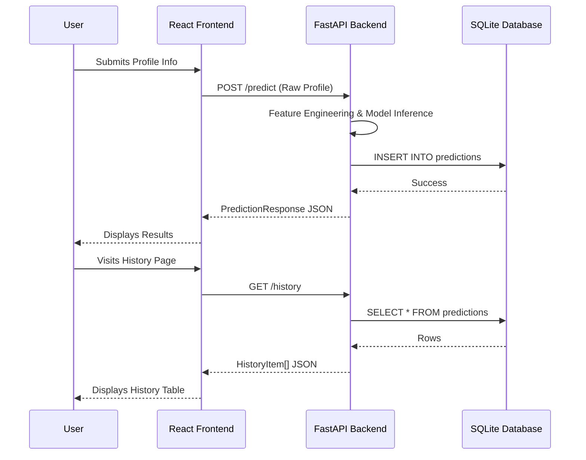

# Integration Notes

## Data Flow Diagram

## Environment Variables
The frontend uses the following environment variables (stored in `.env.development`):

| Variable | Default Value | Description |
| :--- | :--- | :--- |
| `VITE_API_BASE_URL` | `http://127.0.0.1:8000` | The base URL for the FastAPI backend. |
| `VITE_USE_MOCK_DATA` | `false` | Set to `true` to run the frontend entirely in mock mode without the backend. |

## Switching Mock / Real Mode
To test the application without a running backend:
1. Open `.env.development` (or create `.env.local`).
2. Set `VITE_USE_MOCK_DATA=true`.
3. Restart the Vite dev server (`npm run dev`).
The app will display the "Demo Data" badge and use hardcoded offline data.
