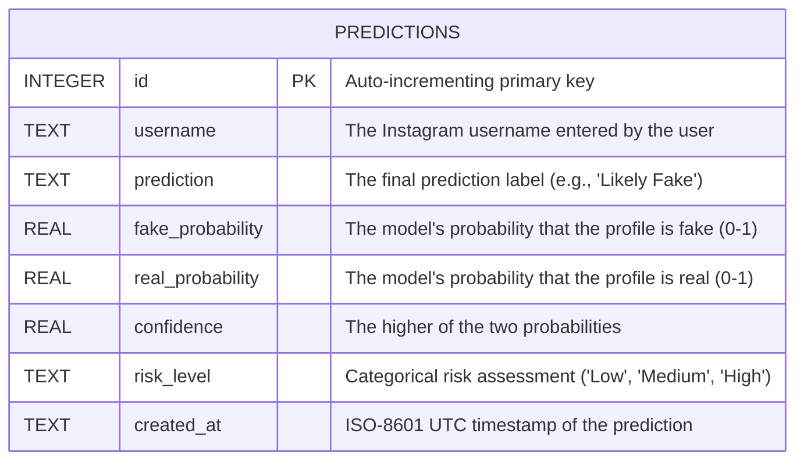

# Database Design

## Purpose
This document outlines the design of the SQLite database used to store the prediction history for the Fake Instagram Profile Detector application. It serves as an educational component for the project presentation and demonstrates a basic data persistence layer.

## Entity-Relationship Diagram

## Column Dictionary
| Column Name | Data Type | Description | Constraints |
| :--- | :--- | :--- | :--- |
| `id` | INTEGER | Primary identifier for the prediction request. | PRIMARY KEY, AUTOINCREMENT |
| `username` | TEXT | The Instagram username entered by the user for analysis. | NOT NULL |
| `prediction` | TEXT | The model's classification output (e.g., "Likely Fake", "Likely Real"). | NOT NULL |
| `fake_probability` | REAL | The calculated probability of the profile being fake. | NOT NULL, CHECK (0-1) |
| `real_probability` | REAL | The calculated probability of the profile being real. | NOT NULL, CHECK (0-1) |
| `confidence` | REAL | The confidence score of the prediction (max of fake/real probs). | NOT NULL, CHECK (0-1) |
| `risk_level` | TEXT | The risk level category based on the fake probability. | NOT NULL, IN ('Low', 'Medium', 'High') |
| `created_at` | TEXT | The timestamp when the prediction was made. | NOT NULL |

## Design Choices
- **Why SQLite:** The application requires a simple, lightweight, zero-configuration database that doesn't need a separate server process. SQLite is perfect for local deployments and educational demonstrations.
- **Why a connection per call:** FastAPI handles requests concurrently in a thread pool. A new connection per call ensures thread safety in a simple and robust manner without complex connection pooling.
- **Separation of Training Data:** The ML training data (CSV) is completely separate from this database. The SQLite database exclusively stores user queries and application history, reinforcing the architectural boundary between the static model artifacts and the dynamic application state.
